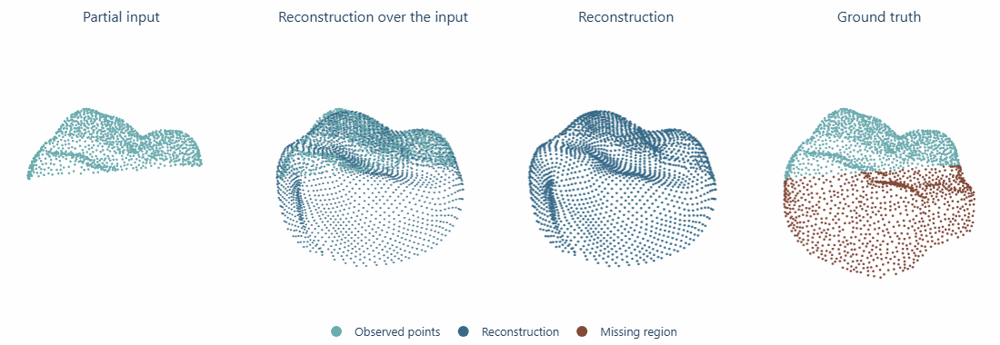
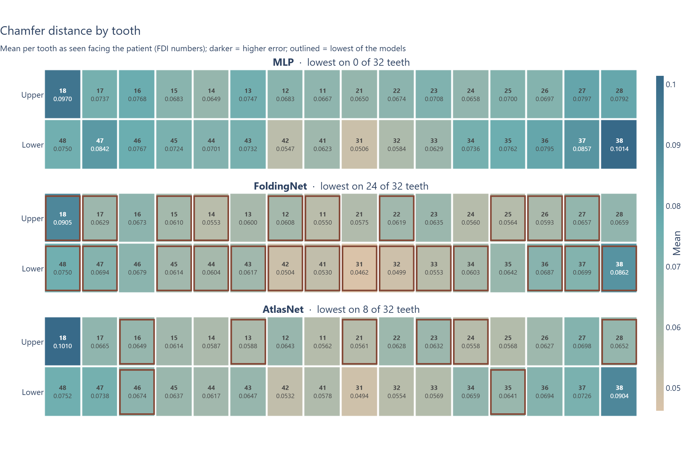
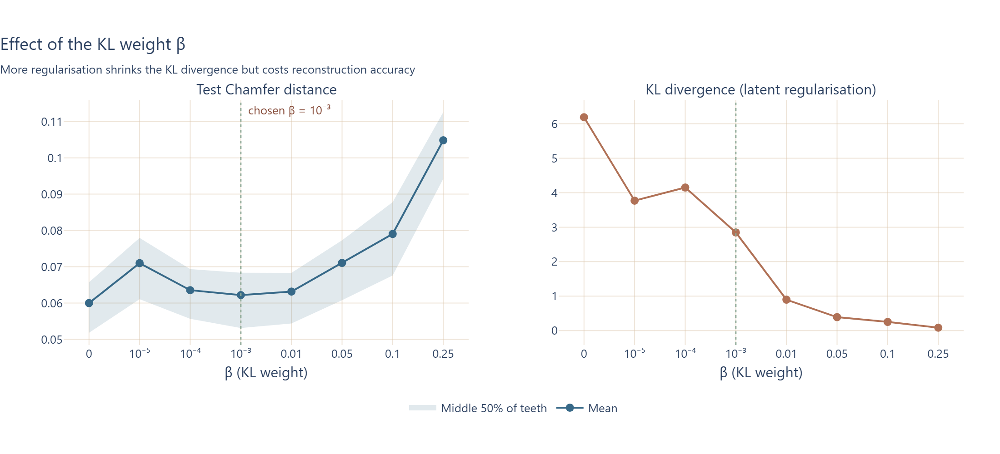
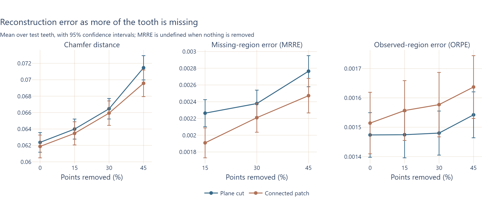
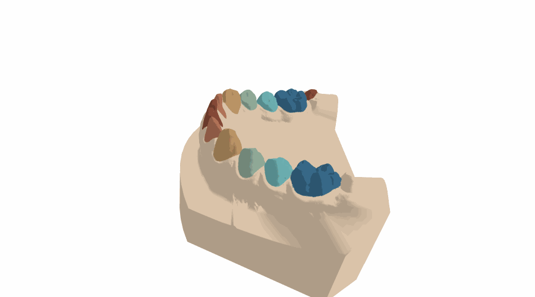
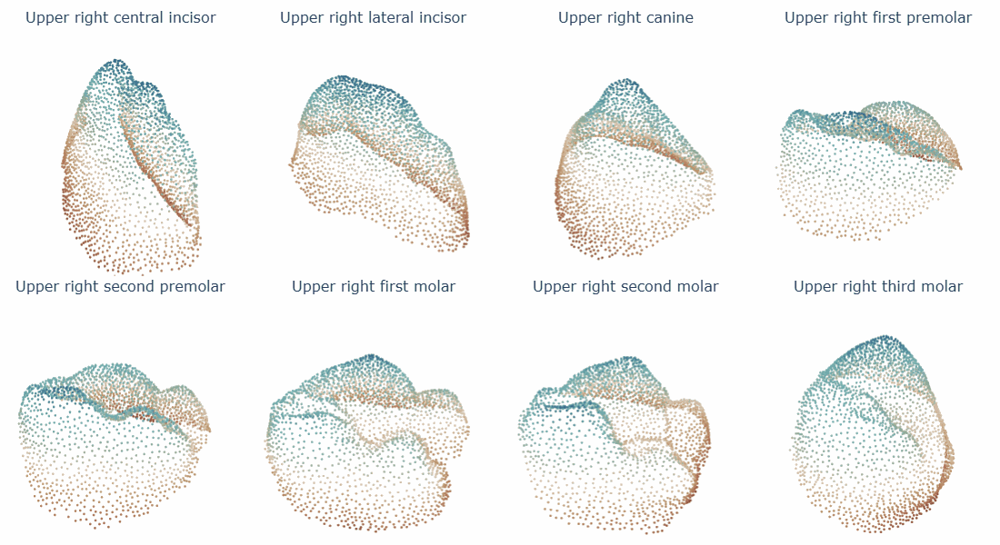
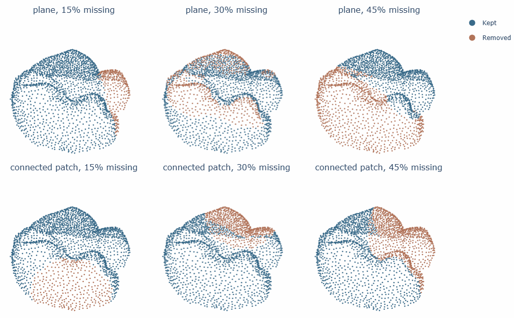
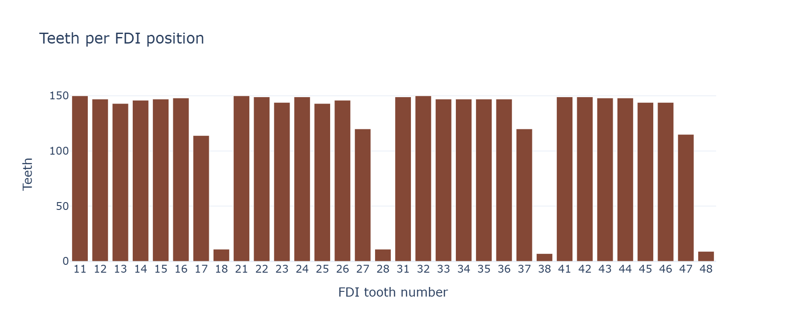
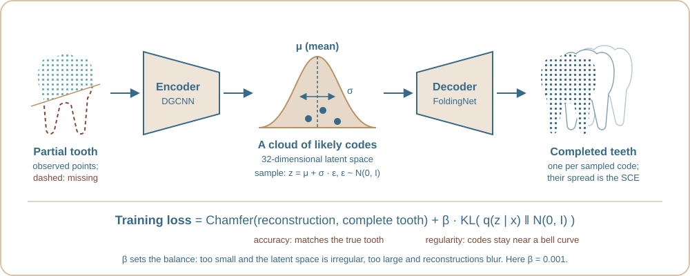

# dental-3d-vae: completing incomplete 3D tooth scans

<p align="center">
  
  <br>
  <em>One of the model's best molar completions: an upper first molar with 45% of it removed by a plane cut
  (Chamfer distance 0.053; the median for molars at this level is 0.072).</em>
</p>

Intra-oral 3D scans are often incomplete: the scanner cannot see behind neighbouring teeth, the patient
moves, braces get in the way. This project trains a **β-variational autoencoder (β-VAE)** on point
clouds of real teeth to rebuild the missing geometry, and asks two questions: how *accurately* does it
complete a tooth, and how *consistently*, given that a VAE can produce many plausible completions of
the same input?

Consistency matters because in clinical use there is no complete tooth to check a completion against.
A model that rebuilds the same partial tooth differently each time is signalling that it is unsure, and
that uncertainty is exactly what a clinician would need to see. This project measures it, and finds
that it cannot stand in for accuracy: how much the model agrees with itself is only weakly related to
how right it is, so a reliable system needs to report both.

It is the MSc dissertation of **Dylan Gelbier** (MSc Artificial Intelligence, Loughborough University,
2026), rebuilt from research code into a tested, documented Python package. Every result below
reproduces the dissertation exactly.

## Highlights

- **A full pipeline on clinical data:** 300 intra-oral jaw scans → 4,038 segmented teeth → 32,304
  controlled partial teeth → trained models → per-tooth evaluation.
- **Architecture study:** 4 point-cloud encoders × 3 decoders and an 8-value KL-weight ablation. The
  chosen DGCNN + FoldingNet model is 14% more accurate than an MLP decoder with 91% fewer parameters.
- **Evaluation beyond one number:** global accuracy (Chamfer distance), recovery of the missing region,
  preservation of the observed region, and the consistency of sampled completions, per tooth position.
- **Verified rewrite:** all 16 trained models load unchanged and give identical outputs to the original
  code; the report's result tables reproduce exactly from the stored per-tooth results.
- **Engineering:** 98 automated tests, seeded and reproducible data generation, CPU-safe local
  development with GPU training on Google Colab, and licensed patient data kept out of Git (a test
  enforces it).

## Contents

- [Results](#results)
- [How it works](#how-it-works): [data](#data-preparation), [models](#models), [metrics](#metrics), [training and evaluation](#training-and-evaluation)
- [Getting started](#getting-started)
- [Repository layout](#repository-layout)
- [Reproducibility](#reproducibility)
- [Data, licence and citation](#data-licence-and-citation)

## Results

Every model is tested on the same 606 held-out teeth (2,424 partial teeth for the completion models).

**Choosing the architecture** (complete teeth in, complete teeth out; one change per experiment):

- **Encoder:** the four encoders end within 5% of each other in mean Chamfer distance, a gap similar
  to the variation between reruns. DGCNN was kept for its fast early learning and its explicit
  modelling of local neighbourhoods.
- **Decoder:** FoldingNet beats the MLP decoder by 14% in mean Chamfer distance with 91% fewer
  parameters (646,278 against 7.0 million) and is the best of three decoders on 24 of the 32 tooth
  positions. For every model, lower incisors are the easiest teeth and third molars the hardest:

<p align="center">
  
</p>

- **KL weight β:** more regularisation shrinks the KL divergence but costs accuracy. β = 0.001 keeps
  reconstruction close to the unregularised model (mean Chamfer distance 0.0622 against 0.0600) while
  more than halving the KL divergence, so the completion models use it:

<p align="center">
  
</p>

**Completing partial teeth** (DGCNN + FoldingNet, β = 0.001, one model per removal method):

- Mean Chamfer distance is 0.0661 for plane cuts and 0.0652 for connected patches. It rises steadily
  with the amount removed: by 12% (plane) and 10% (patch) from 15% to 45% missing, most in the third
  molars.
- The observed-region error barely moves: the model keeps what it was shown, even with almost half
  the tooth missing.
- Chamfer distance tracks the local errors (Pearson r = 0.78-0.90 with MRRE and ORPE) but not
  perfectly, so a good overall score can hide a poorly rebuilt missing region.

<p align="center">
  
</p>

- In the dissertation, stochastic consistency (mean SCE 0.0313 and 0.0314) was only weakly correlated
  with accuracy (r = 0.29 and 0.20): a model agreeing with itself says little about whether it is
  right. SCE was not stored with the models; recomputing it here needs a GPU and is still to do.

## How it works

### Data preparation

Intra-oral jaw scans become a dataset of individual teeth, each a normalised 2,048-point cloud, and
then controlled incomplete versions of every tooth.

<p align="center">
  
  
</p>

1. **Jaw scan → teeth.** Each scan comes with one label per vertex (0 = gum, otherwise the tooth's
   [FDI number](https://en.wikipedia.org/wiki/FDI_World_Dental_Federation_notation)). Each tooth
   keeps only the faces whose three vertices carry its label, then only its largest connected piece.
2. **Tooth → point cloud.** 8,192 points are sampled uniformly over the tooth surface, then thinned
   to 2,048 evenly spread points by farthest point sampling.
3. **Normalise.** Centre on the centroid and scale so the farthest point is at distance 1.
4. **Save.** `teeth_dataset.h5` (`points`: N × 2048 × 3, float32), `metadata.csv` (one row per
   tooth: patient, jaw, FDI number, tooth type, mesh size, bounding box) and `dataset_info.json`.

Scans are processed in parallel on every CPU core, and each scan's sampling is seeded from its name,
so the output is identical whatever the number of workers. A scan that fails is skipped and listed in
`dataset_info.json`. On 300 scans (20 cores) the build takes under two minutes and gives 4,038 teeth,
split 70/15/15 into training, validation and test sets, stratified by tooth type.

**Partial teeth.** To study how well a model recovers missing geometry, every tooth is cut in two
controlled ways, removing 0, 15, 30 or 45% of its points:

- **Plane cut:** everything beyond a randomly oriented plane, like a scan's field of view ending.
- **Connected patch:** a random point and its nearest neighbours, like a localised hole.

<p align="center">
  
</p>

This gives 32,304 partials (4,038 teeth × 2 methods × 4 levels) in about four seconds. Only *which*
points each partial lost is stored (`partial_masks.h5`, one true/false per point, 9 MB), so every
partial and its missing region are rebuilt exactly from the complete tooth, and each plane cut's plane
can be recovered for display. Each partial is seeded from (seed, tooth, method, fraction), so every
model sees exactly the same incomplete teeth, and the masks carry a fingerprint of the complete
dataset they belong to, so they cannot be paired with the wrong one.

For training, the kept points are padded back to 2,048 by adding points between observed neighbours,
so nothing comes from the missing region. Every partial inherits its source tooth's
train/validation/test split, so no tooth is used for training in one form and testing in another.

**Dataset.** [Teeth3DS+](https://osf.io/xctdy/) (Ben-Hamadou et al., 2022): clinically acquired
intra-oral scans with per-vertex tooth labels. This project uses `data_part_1`: 300 jaw scans (150
upper, 150 lower) from 300 patients. Third molars are rare in it (7–11 of each, against 115–150 for
every other position), which is one reason they are the hardest teeth to reconstruct:

<p align="center">
  
</p>

### Models

**What a β-VAE is.** An autoencoder compresses its input into a short code and rebuilds it from that
code. A *variational* autoencoder (VAE) does not output one code for a tooth but a small cloud of
likely codes: a mean μ and a spread σ in a 32-dimensional latent space. During training a code is
sampled from that cloud, so the decoder learns to turn *any* nearby code into a plausible tooth.

<p align="center">
  
</p>

The training loss has two parts: the Chamfer distance between the reconstruction and the complete
tooth (accuracy), and the KL divergence, which pulls every cloud towards a standard bell curve
(regularity). The weight β on the KL term, the "β" in β-VAE, sets the balance between them, which is
what the β experiment in [Results](#results) measures. Once trained, decoding the mean μ gives the
model's best single completion; decoding several sampled codes gives several plausible completions,
and how much those agree is the stochastic consistency error (SCE).

Encoders and decoders are interchangeable, e.g. `build_vae("dgcnnv2", "foldingnet")`:

| | Name | Idea |
|---|---|---|
| Encoder | `simple_pointnet` | PointNet (Qi et al., 2017): a shared per-point MLP, then a max-pool over all points |
| Encoder | `tnet_pointnet` | PointNet with learned alignment transforms (T-Nets) for the input points and their features |
| Encoder | `pointnet_plus_plus` | PointNet++ (Qi et al., 2017b): PointNet applied to local neighbourhoods at three scales |
| Encoder | `dgcnnv2` | A reduced DGCNN (Wang et al., 2019): edge convolutions over nearest-neighbour graphs, rebuilt from the learned features at every layer |
| Decoder | `mlp` | Predicts every coordinate directly |
| Decoder | `foldingnet` | FoldingNet (Yang et al., 2018): folds a flat 2D grid into the surface, in two steps |
| Decoder | `atlasnet` | AtlasNet (Groueix et al., 2018): the surface as four learned, deformed squares |

**Verified against the dissertation.** The models were rewritten from the dissertation code (about
2,850 lines down to 350) with every layer name kept, so all 16 trained checkpoints load unchanged
with `load_checkpoint`. Each was verified by running the original code and the rewrite on the same
test teeth on the same CPU: the outputs are identical, and so are the parameter counts.
Reconstructions stored from the training GPUs differ only by floating-point arithmetic (TF32
convolutions on the A100), which changes mean reconstruction error by at most 0.013%. Training was
verified the same way: from the same seed and starting weights, the original and rewritten training
steps give identical weights for T-Net PointNet, and for DGCNN agree as closely as the original code
agrees with itself between runs.

One change is deliberate. The dissertation's PointNet++ started farthest point sampling at a random
point, so even its deterministic reconstructions varied between runs: by up to 13% per tooth, though
under 0.2% on average. It now starts at point 0, as the original PointNet++ implementation does, and
a test keeps the encoder deterministic.

### Metrics

No single number captures how well a tooth was completed, so each reconstruction is scored four
ways, one value per tooth:

| Metric | Question it answers | Definition |
|---|---|---|
| Chamfer distance (CD) | How close is the whole reconstruction to the complete tooth? | Mean distance from each point to its nearest point in the other cloud, in both directions, summed |
| Missing-region error (MRRE) | Was the removed part recovered? | Mean squared distance from each *removed* point of the complete tooth to the reconstruction |
| Observed-region error (ORPE) | Was the part the model could see kept intact? | The same, over the *observed* points |
| Stochastic consistency error (SCE) | Do repeated samples from the latent distribution agree? | Mean CD over all pairs of K sampled reconstructions of the same input (K = 10) |

MRRE is undefined when nothing was removed, so 0%-missing inputs are left out of its averages. CD
uses plain distances and MRRE and ORPE squared ones, as in the dissertation, so their values are not
on the same scale: compare each metric across models, not metrics with each other. SCE measures
*consistency*, not accuracy: a model can agree with itself and still be wrong, which is why it is
reported alongside CD.

The implementations reproduce the per-tooth CD and MRRE stored in the dissertation checkpoints. One
change: ORPE is now measured on the observed points themselves, as the metric is defined, rather than
on the model's upsampled input, which also contains interpolated points (mean ORPE changes by under
0.4%).

### Training and evaluation

The loss is the Chamfer distance between a *sampled* reconstruction and the complete tooth, plus β ×
the KL divergence (plus a small alignment penalty for the T-Net encoder), minimised with Adam. After
every epoch the model is scored on the validation set from its *mean* latent (no sampling); the best
model is saved as soon as it is found, and training stops after 20 epochs without improvement.

Each run is one folder: its config, the software and hardware it ran on (including the Git commit),
one line of metrics per epoch, the best model and a summary. Evaluation adds one row per test tooth
with every metric, and the charts above are built from those rows, so new runs and the dissertation's
models are compared with the same code.

## Getting started

### Setup

Python 3.10 or later. From the repository folder in PowerShell (no need to activate the environment):

```powershell
python -m venv .venv
.venv\Scripts\python -m pip install -r requirements.txt
.venv\Scripts\python -m pip install -e .
.venv\Scripts\python -m pytest -q
```

On macOS or Linux, use `.venv/bin/python`. In VS Code, select the `.venv` kernel for notebooks.

### Notebooks

Run in order; each one's first cell sets it up for Google Colab automatically and does nothing locally.

| Notebook | What it does | Where |
|---|---|---|
| `01_gpu_check.ipynb` | Checks the GPU and the PyTorch and CUDA versions | Colab |
| `02_data_preparation.ipynb` | Jaw scans → teeth → partial teeth, with 3D views of every step | Local (uses every CPU core) |
| `03_train_experiment.ipynb` | Trains one configuration (the dissertation's final model by default) | Colab GPU |
| `04_evaluate_run.ipynb` | Tests a trained model (a new run or a dissertation checkpoint): per-tooth metrics, charts, best/median/worst teeth in 3D, and a comparison of all runs | Colab GPU |
| `05_dissertation_results.ipynb` | The experiments in [Results](#results), from the stored results; regenerates the figures above | Local, under a minute |

**Data.** Download `data_part_1` from the [Teeth3DS+ page](https://osf.io/xctdy/), put its `upper/`
and `lower/` folders in `data/raw/teeth3ds/`, and run notebook 02 with `REBUILD = True`. For Colab,
upload the processed folders (`data/processed/complete_rebuilt/` and `partial_rebuilt/`) to
`MyDrive/dental-3d-vae/data/processed/`. The dissertation's trained models are not in this
repository; notebooks 04 and 05 expect them in `artifacts/dissertation_checkpoints/`.

**Colab.** Open a notebook with File > Open notebook > GitHub, pick a GPU runtime and run all cells:
the first cell downloads the latest code, with nothing to set up. (Only if the repository is private,
for example a private copy: add a fine-grained, read-only GitHub token as a Colab secret named
`GITHUB_TOKEN`, with notebook access.)
To run your own changes, push them, then in Colab use Runtime > Restart session and run all cells.
Runs are saved to `MyDrive/dental-3d-vae/runs/` (locally `artifacts/runs/`).

From a Python script, guard the dataset build (worker processes re-import the script on Windows):

```python
from pathlib import Path

from dental_3d_vae.ml.preprocessing import build_complete_dataset

if __name__ == "__main__":
    build_complete_dataset(Path("data/raw/teeth3ds"), Path("data/processed/complete"))
```

## Repository layout

```
src/dental_3d_vae/
├── ml/
│   ├── preprocessing.py   jaw scans → teeth → normalised point clouds
│   ├── partial.py         plane cuts, connected patches, upsampling, the partial dataset
│   ├── data.py            train/validation/test split, PyTorch datasets and loaders
│   ├── models/            VAE, PointNet, T-Net PointNet, PointNet++, DGCNN; MLP, FoldingNet, AtlasNet
│   ├── metrics.py         Chamfer distance, MRRE, ORPE, SCE
│   ├── train.py           loss, validation, early stopping
│   └── evaluate.py        per-tooth test results and summaries
├── experiments/
│   ├── config.py          ExperimentConfig: every setting of a run
│   ├── runs.py            run folders: config, environment, metrics, best model
│   └── dissertation.py    the dissertation's checkpoints in this package's formats
├── runtime/               device, seeding, Colab and Google Drive handling
└── viz/
    ├── plotting.py        chart theme and training curves
    ├── results.py         dental chart, distributions, β ablation, missingness, scatters, tables
    └── pointclouds.py     3D jaws, teeth, partial teeth and completions
notebooks/                 the five notebooks above
tests/                     98 tests, run on a CPU in about 25 seconds
docs/figures/              the figures in this README
```

Kept locally and ignored by Git: `data/` (licensed scans and processed datasets), `artifacts/`
(trained models and runs) and the original dissertation notebooks and report.

## Reproducibility

- **Data:** dataset builds are seeded per scan and partials per (seed, tooth, method, fraction), so
  they are identical on every machine and with any number of workers; partial masks carry a
  fingerprint of their complete dataset. The split reproduces the dissertation's exactly.
- **Runs:** each run saves its full config, the Python, PyTorch and CUDA versions, the GPU and the Git
  commit (flagging uncommitted changes). Models are seeded before they are built; evaluation samples
  from its own seeded generator, so its results do not depend on what ran before.
- **Hardware:** GPU arithmetic is not bit-for-bit reproducible, so expect GPU runs to differ from each
  other in the last digits (on the dissertation's models, by at most 0.013% in mean error).
- **PyTorch version:** the local `torch` pin in `requirements.txt` matches Colab's preinstalled
  version (currently 2.11.0); locally it is the CPU build. Never `pip install torch` in Colab; when
  Colab's version changes (shown by notebook 01), update the pin and reinstall locally:

```powershell
.venv\Scripts\python -m pip install "torch==<version>" --index-url https://download.pytorch.org/whl/cpu
```

## Data, licence and citation

**Data.** Teeth3DS+ is distributed under its own licence, so no scans, teeth or derived point clouds
are in this repository. `data/` is ignored by Git, and a test fails if a notebook is saved with
outputs (they would contain the data). Please cite the dataset if you use it:
A. Ben-Hamadou et al., *Teeth3DS+: An Extended Benchmark for Intra-oral 3D Scans Analysis*, 2022.

**Code.** MIT licence: see [LICENSE](LICENSE).

**Citation.** D. Gelbier, *Reliable 3D Tooth Point-Cloud Completion Using a β-VAE: Reconstruction
Accuracy and Stochastic Consistency Evaluation*, MSc dissertation, Loughborough University, 2026.
